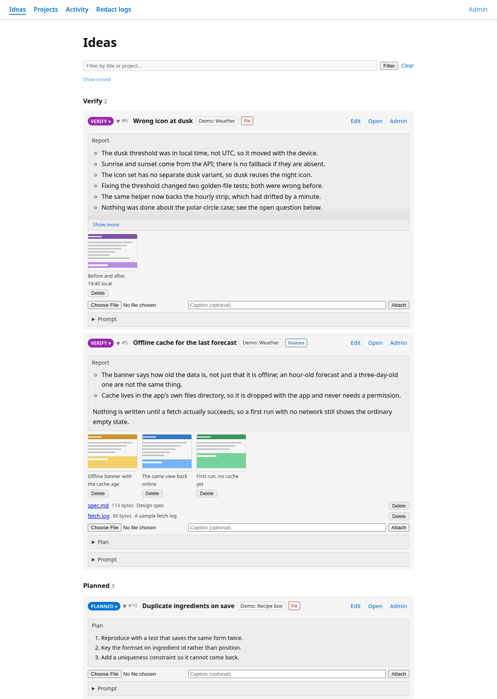

# claude-manager

A small, self-hosted idea board for working with [Claude Code](https://claude.com/claude-code)
across many projects. You write ideas down; agents pick them up, store a plan on them,
implement them and report back, all on the same record.

> [!WARNING]
> **There is no authentication.** Anyone who can reach the port can read, create, edit and
> re-status every record, through the web UI, the JSON API and the MCP endpoint alike.
> Run it on localhost or a private network (a VPN or tailnet) only, never on the public
> internet. Put an authenticating proxy in front of it first if you must expose it.



## What it does

- **Projects and ideas.** A project is a folder under one workspace root. An idea belongs to a
  project and has a kind (fix, feature, design, question, other), a goal, context and notes,
  and moves through `new → planned → verify → implemented` (or `abandoned`).
- **Plan, report, review.** An agent stores its plan on the idea before implementing it, writes
  a short report afterwards and moves the idea to `verify`. Review findings go back onto the
  idea and reopen it. Commit hashes are recorded too, so `git blame` leads back to the idea.
- **Generated prompts.** Every idea renders into a Markdown prompt (cd into the project, read its
  `CLAUDE.md`, then title, goal, context, notes, plan, review) that you can copy into a session.
- **MCP endpoint** at `/mcp/` (streamable HTTP) with tools to list, read, create, update and
  transition projects and ideas, and to attach screenshots and other files.
- **JSON API** at `/api/` with an OpenAPI 3.1 document and Swagger UI at `/api/docs/`.
- **Lookup hook** (`hooks/cm-lookup.py`): a Claude Code hook that injects the matching ideas into
  the session whenever a prompt names `#123`, a bare project name, or (on the first prompt) words
  from an idea's title.
- **Git status per project** (`sync_git_status`), an **activity feed**, a PWA manifest, and a
  JS-off fallback for every form.
- **Log redaction** at `/redact/` (optional): drop a log file, it is scrubbed in the request path
  and the redacted copy is written into a case folder on the server. The raw upload never
  touches disk. Covered: public IPs, emails, MACs, URLs, Wi-Fi SSIDs, vendor API keys and
  tokens, JWTs, `Authorization` headers and passwords; VPN identities (WireGuard, Tailscale and
  Headscale, ZeroTier, OpenVPN); chat servers (Matrix, Zulip); JSON-lines exports (Loki,
  VictoriaLogs, Docker, journald); and Android logcat dumps, cut down to the VPN client's own
  process. `redact/log_redact.py` is also a stdlib-only CLI for scrubbing inside a pipe.

## Docker

```bash
cd docker
docker compose up --build    # serves on :8080
```

Open <http://localhost:8080/>. Migrations run on start. The image runs as uid/gid 1000, so
bind-mount sources must be owned by uid 1000. See the comments in `docker/docker-compose.yml`
for mounting the workspace (for `sync_git_status`) and enabling `/redact/`.

## Configuration

Settings come from environment variables. A `.env` file next to `manage.py` (git-ignored,
plain `KEY=VALUE` lines) is read too; a variable set in the real environment wins.

| Variable | Default | Meaning |
|---|---|---|
| `DOMAIN` | *(empty)* | Comma-separated host names the server answers to, besides `localhost`/`127.0.0.1`. Each also becomes an `https://` CSRF trusted origin. |
| `CM_WORKSPACE_ROOT` | `/workspace` | The directory holding one folder per project. Prompts tell agents to `cd` to `<root>/<folder>` and read `<root>/CLAUDE.md`. |
| `CM_BASE_URL` | `http://localhost:8000` | How agents reach this server; named in MCP tool texts (e.g. the upload endpoint for large files). |
| `CM_GIT_WEB_BASE` | *(unset)* | Commit links for projects not hosted on GitHub: `<base>/<folder>/commit/<hash>`. Unset: GitHub projects get links, others show the bare hash. |
| `DISPLAY_TIME_ZONE` | `UTC` | Time zone of the activity feed. |
| `DB_PATH` | `db.sqlite3` | SQLite database file. |
| `LOG_ANALYSIS_ROOT` | *(unset)* | Enables `/redact/`: the directory that holds one folder per case. |
| `REDACT_STATE_DIR` | `.redact-state/` | Per-case salt and names list for `/redact/`. Must be writable and persistent (not a tmpfs). |
| `DEBUG` | `True` | Set `False` in production, together with `SECRET_KEY`. |

For production, copy `claude_manager/production.py.example` to `claude_manager/production.py`
(git-ignored); it is imported at the end of `settings.py`.

## Connecting Claude Code

The examples below use `localhost:8000`, the manual installation's port; with Docker it is
`localhost:8080`. Register the MCP endpoint once, at user scope, so every project sees the tools:

```bash
claude mcp add --scope user --transport http claude-manager http://localhost:8000/mcp/
```

To install the lookup hook, link it into place and register it for `SessionStart` and
`UserPromptSubmit` in `~/.claude/settings.json`, pointing `CM_API` at your instance:

```bash
mkdir -p ~/.claude/hooks
ln -s "$PWD/hooks/cm-lookup.py" ~/.claude/hooks/cm-lookup.py
python3 hooks/cm-lookup.py --selftest
```

```json
{
  "env": { "CM_API": "http://localhost:8000/api/ideas/" },
  "hooks": {
    "SessionStart": [{ "hooks": [{ "type": "command", "command": "python3 ~/.claude/hooks/cm-lookup.py" }] }],
    "UserPromptSubmit": [{ "hooks": [{ "type": "command", "command": "python3 ~/.claude/hooks/cm-lookup.py" }] }]
  }
}
```

The hook always exits 0; if the server is unreachable it injects a one-line note instead.
Its per-session state lives in `~/.cache/cm-lookup/` (`CM_LOOKUP_STATE` overrides it).

A workspace-level `CLAUDE.md` that tells agents to look up the matching idea first, store
plans on it and record reports and commits makes the loop work; the MCP tool descriptions
carry the same instructions.

## Manual installation

Requires Python 3.12+ and [uv](https://docs.astral.sh/uv/).

```bash
uv sync
uv run python manage.py migrate
uv run python manage.py seed_demo          # optional: demo projects and ideas
uv run python manage.py runserver 0.0.0.0:8000
```

Open <http://localhost:8000/>. Run the tests with `uv run python manage.py test`.

## License

MIT, see [LICENSE](LICENSE).
